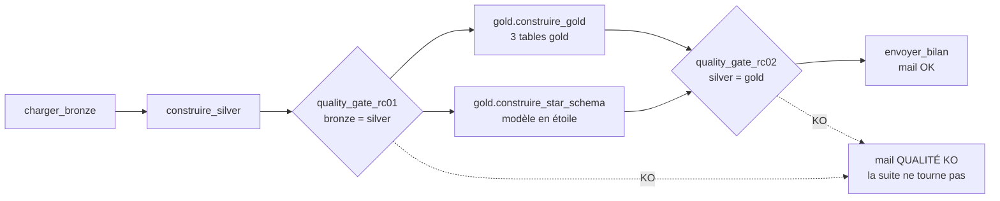
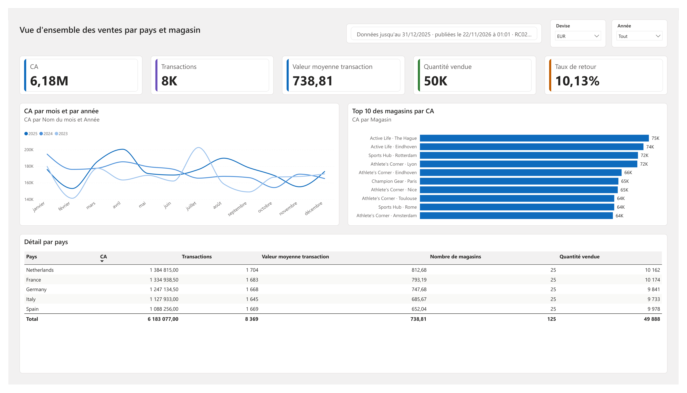
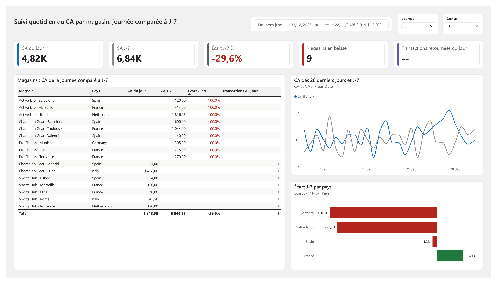
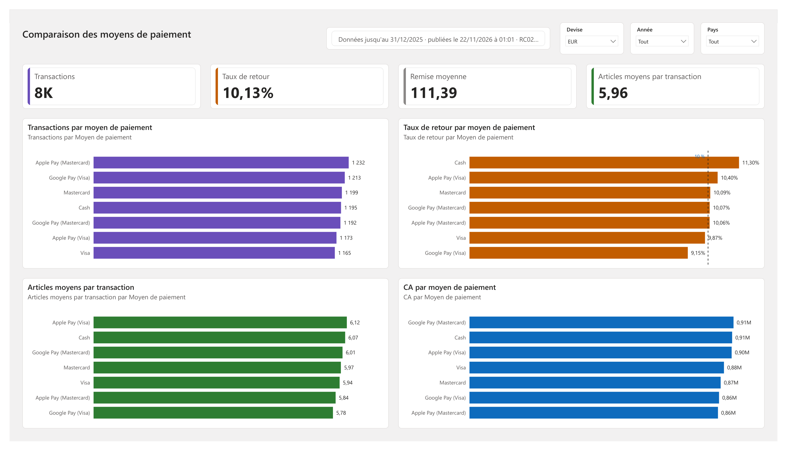
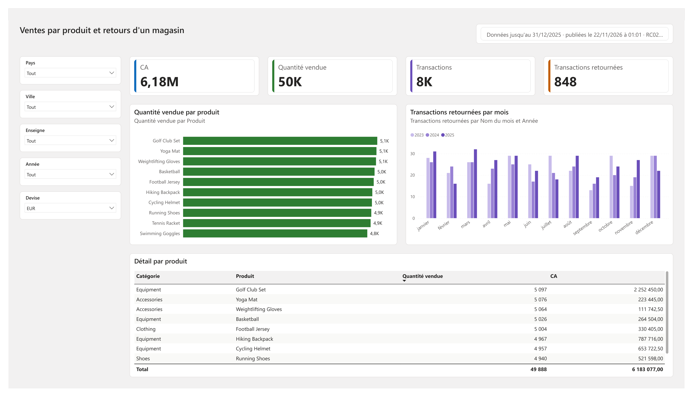

# Lab Sales Analysis


Réalisation d'un pipeline de données qui analyse les ventes d'un réseau international de magasins de sport : il contrôle les livraisons des systèmes de caisse (POS) avant publication puis alimente un rapport Power BI pour suivre l'activité selon les axes d'analyse suivants :

- magasin
- pays
- devise
- moyen de paiement

## Sommaire

1. [Besoin métier](#besoin-métier)
2. [Structure du projet](#structure-du-projet)
3. [Données](#données)
4. [Modèle de données](#modèle-de-données)
5. [Pipeline Airflow](#pipeline-airflow)
6. [Rapport Power BI](#rapport-power-bi)
7. [Démarrer l'environnement](#démarrer-lenvironnement)
8. [Documentation](#documentation)
9. [État d'avancement](#état-davancement)

## Besoin métier

La direction souhaite obtenir une vue à 360° de son activité commerciale. Le chiffre d'affaires (CA) qu'elle consulte chaque matin peut être faussé par une livraison en retard ou en double, sans que rien ne le signale.

Le projet répond à ces deux problèmes :

- **Analyser l'activité** : trois tables d'analyse qui répondent aux douze questions que se pose le client.
- **Garantir la qualité des données** : aucune donnée incomplète ou en double n'est publiée et le rapport indique jusqu'à quelle date les données sont complètes.

## Structure du projet

```text
Lab_Sales_Analysis/
├── config/             modèles des fichiers de secrets (sans mot de passe)
│   └── modele/         description des tables, un CSV par table : source du DDL et du MPD
├── dags/               DAG Airflow du pipeline
├── data/
│   ├── raw/            fichier source fourni par le client, jamais modifié
│   └── archive/        copie de chaque fichier intégré, nommée par son empreinte (hors dépôt)
├── docs/               documentation du projet
│   ├── images/powerbi/ captures des pages du rapport Power BI
│   └── modeles/        modèles de données (MCD et MPD)
├── grafana/            source de données et tableau de bord de suivi des exécutions
├── scripts/            scripts Python (détail dans scripts/README.md)
├── sql/
│   ├── controles/      mesures par couche pour les portes qualité
│   ├── gold/           requêtes des 3 tables gold
│   ├── gold_star_schema/  requêtes du modèle en étoile
│   └── questions/      une requête par question métier, Q1 à Q12
├── tests/dags/         test d'intégrité du DAG
├── .gitattributes      règles de fins de ligne
├── .gitignore          fichiers exclus du dépôt
├── docker-compose.yml  environnement PostgreSQL, Airflow, Mailpit et Grafana
└── README.md
```

## Données

Le fichier source `data/raw/pos_sales_data_30k.json` contient 30 000 tickets de caisse enregistrés entre 2023 et 2025 dans 18 pays. Chaque ticket peut contenir plusieurs articles.

## Modèle de données

Le modèle conceptuel de données (MCD, notation Merise) décrit les ventes avec le vocabulaire du métier. Il est construit à partir des constats du [profilage](docs/02_profilage_source.md).


Points clés :

- le **ticket de vente** est au centre : il est payé par un moyen de paiement, enregistré dans un magasin et peut bénéficier d'un code promo 
- un **magasin** est une enseigne dans une ville (450 magasins), car l'identifiant `store_id` de la source n'est pas fiable ;
- la quantité et le prix appartiennent à la **ligne de vente** (association CONTENIR), car le prix d'un même produit varie d'une vente à l'autre 
- la **devise** est rattachée au pays : chaque pays utilise une seule devise, et l'euro est partagé par 5 pays.

### Modèle physique

Le modèle physique de données (MPD) décrit les tables PostgreSQL réellement créées. Chaque table est décrite par un fichier CSV dans `config/modele/` ; à partir de ces fichiers, `scripts/03_generer_ddl.py` crée les tables et `scripts/08_generer_mpd.py` écrit le MPD en [DBML](docs/modeles/mpd.dbml), dessiné avec dbdiagram.io. Le MPD et la base ne peuvent donc pas diverger. Les tables sont rangées en couches, selon l'architecture médaillon :

| Schéma | Tables | Rôle |
| --- | --- | --- |
| `bronze` | `pos_sales_raw` | Tickets tels que livrés, au format JSON, sans correction |
| `silver` | `exploded_products` | Données contrôlées : un ticket découpé en lignes article (59 928 lignes) |
| `gold` | `store_sales_summary`, `daily_sales_country_currency`, `payment_method_analysis` | Les 3 tables gold qui répondent aux 12 questions métier |
| `gold` | `dim_date`, `dim_magasin`, `dim_produit`, `dim_moyen_paiement`, `fait_ticket`, `fait_ligne_vente` | Modèle en étoile pour Power BI, piloté par la date |
| `ops` | `journal_livraisons`, `journal_taches`, `journal_controles` | Suivi de chaque livraison, de chaque tâche Airflow et de chaque porte qualité |


Les 10 tables métier du MCD (magasin, produit, ticket de vente…) ne sont pas construites dans silver : le modèle en étoile de gold couvre les mêmes axes d'analyse pour Power BI.

Choix de modélisation :

- les colonnes des tables demandées par l'énoncé sont reprises à l'identique, noms et types compris : les montants sont en `FLOAT`, comme dans l'énoncé ;
- `bronze` conserve le code promo, absent de `exploded_products` ;
- `store_sales_summary` respecte le grain imposé par l'énoncé (`store_id`). Dans l'étoile, un magasin est une enseigne dans une ville (`dim_magasin`, 450 magasins), car `store_id` n'identifie pas un magasin unique ;
- les montants sont en devise locale : un rapport qui additionne plusieurs pays doit choisir une devise.

## Pipeline Airflow

Le DAG `lab_sales_analysis_pipeline` ([dags/lab_sales_analysis_pipeline.py](dags/lab_sales_analysis_pipeline.py)) tourne chaque jour à minuit (heure de Paris). Il enchaîne les scripts du projet et bloque la publication dès qu'une couche ne retrouve pas les totaux de la précédente.



| Élément | Fonctionnement |
| --- | --- |
| Portes qualité RC01 et RC02 | Comparent 3 mesures entre deux couches : nombre de tickets, CA et quantité (requêtes `sql/controles/`). Écart toléré dans la Variable Airflow `lab_sales_seuil_ecart` (0 par défaut). Une porte KO échoue sans réessai et arrête le DAG |
| Journal des tâches | Chaque tâche écrit dans `ops.journal_taches` au début et à la fin : statut, essai, durée, nombre de lignes, message d'erreur |
| Journal des contrôles | Chaque porte écrit une ligne par mesure dans `ops.journal_controles` : valeurs des deux couches, écart, seuil, OK ou KO |
| Réessais | 2 réessais à 30 s pour les tâches de chargement et de construction, aucun pour les portes : réessayer ne corrige pas un écart de données |
| Mails à l'astreinte | Mailpit en local : bilan des contrôles si tout est OK, alerte avec l'erreur et les contrôles si une tâche échoue |
| Suivi en temps réel | Grafana lit les deux journaux toutes les 5 s, avec un rôle PostgreSQL en lecture seule : dernier run, durées, portes qualité, historique |
| Rattrapage | Un run de rattrapage contrôle sa propre journée : voir la [procédure de rattrapage](docs/04_procedure_rattrapage.md) |
| Paramètre `jour` | Au déclenchement manuel, contrôle une seule journée (AAAA-MM-JJ) ; vide, contrôle toute la table |

Résultat d'un run complet : 30 000 tickets, 19 450 000,75 de CA et 180 091 articles, identiques dans bronze, silver et gold.

Le pipeline ne dépend pas de ses outils de suivi : si Grafana ou Mailpit sont arrêtés, le DAG tourne quand même.

### Test d'intégrité du DAG

[tests/dags/test_dag_integrity.py](tests/dags/test_dag_integrity.py) vérifie, sans base de données, que le DAG se charge et que sa structure n'a pas changé par erreur : 7 tâches, leur ordre, gold protégé par RC01, portes sans réessai, journal et alertes sur chaque tâche. Il tourne dans l'image Airflow, dans un conteneur jetable :

```powershell
docker run --rm -v "${PWD}:/lab" -w /lab apache/airflow:3.4.0 bash -c "pip install -q pytest==8.3.5 && python -m pytest -v -p no:cacheprovider tests/dags"
```

## Rapport Power BI

Le rapport lit le modèle en étoile du schéma `gold` et le journal des contrôles `ops.journal_controles`, en mode Import, avec le rôle PostgreSQL `powerbi_lecture` en lecture seule ([script 09](scripts/09_creer_role_powerbi.py)).

- **Bandeau de fraîcheur** : chaque page indique la dernière journée chargée, l'heure de publication et le résultat de la porte RC02 (critère CS10).
- **Devise** : les montants restent en devise locale, sans conversion. Le segment Devise n'accepte qu'une valeur à la fois (EUR par défaut), pour ne jamais additionner deux devises.

### Vue d'ensemble

CA, transactions, valeur moyenne, quantité et taux de retour ; CA par mois et par année, 10 premiers magasins par CA, détail par pays.



### Suivi quotidien

CA d'une journée comparé au même jour de la semaine précédente (J-7), par magasin et par pays ; les plus fortes baisses en tête du tableau.



### Moyens de paiement

Transactions, taux de retour (avec le seuil de 10 %), articles moyens et CA par moyen de paiement : questions Q9 à Q12.



### Produits d'un magasin

Quantités par produit, retours par mois et détail par catégorie, pour un magasin choisi par pays, ville et enseigne.



## Démarrer l'environnement

L'environnement tourne dans Docker. Le fichier `docker-compose.yml` déclare neuf services :

| Service | Rôle | Accès local |
| --- | --- | --- |
| `postgres-ventes` | Base des ventes : schémas bronze, silver, gold et ops | `127.0.0.1:5440` |
| `postgres-airflow` | Base interne d'Airflow (historique des exécutions) | — |
| `airflow-init` | Prépare la base interne d'Airflow, puis s'arrête | — |
| `airflow-apiserver` | Interface web et API d'Airflow | http://127.0.0.1:8090 |
| `airflow-scheduler` | Déclenche les DAG et exécute leurs tâches | — |
| `airflow-dag-processor` | Lit les fichiers du dossier `dags/` | — |
| `airflow-triggerer` | Exécute les tâches différables | — |
| `mailpit` | Boîte mail de test : reçoit les alertes et les bilans | http://127.0.0.1:8027 |
| `grafana` | Suivi des exécutions en temps réel | http://127.0.0.1:3002 |

Les ports ne sont ouverts que sur la machine locale (`127.0.0.1`).

### 1. Préparer les secrets

Aucun mot de passe n'est stocké dans le dépôt. Les secrets sont lus dans un dossier `data_connection/`:

```text
Bootcamp_Data_Engineer/
├── data_connection/                      hors du dépôt
│   ├── lab_sales_postgres_ventes.env
│   ├── lab_sales_postgres_airflow.env
│   ├── lab_sales_airflow.env
│   ├── lab_sales_grafana.env
│   └── lab_sales_powerbi.env
└── Lab_Sales_Analysis/                   ce dépôt
```

Copier les cinq modèles de `config/` dans ce dossier, sous les noms indiqués en première ligne de chaque modèle puis remplacer chaque `a_remplacer` :

- les mots de passe PostgreSQL : lettres et chiffres uniquement identiques dans les fichiers PostgreSQL et dans `lab_sales_airflow.env` ;
- la clé Fernet qui chiffre les connexions enregistrées dans Airflow :

```powershell
python -c "import base64, os; print(base64.urlsafe_b64encode(os.urandom(32)).decode())"
```

- le secret JWT qui signe les sessions de l'interface (64 caractères) :

```powershell
python -c "import secrets; print(secrets.token_urlsafe(48))"
```

- les deux mots de passe de Grafana (compte `admin` et rôle `grafana_lecture`), avec la même commande.

### 2. Lancer les services

```powershell
docker compose up -d
```

```powershell
docker compose ps
```

Au premier lancement `airflow-init` prépare la base d'Airflow : Les autres services passent à l'état `Up`.

Au premier lancement, créer aussi les tables, puis le rôle de lecture de Grafana :

```powershell
python scripts/03_generer_ddl.py
```

```powershell
python scripts/07_creer_role_grafana.py
```

### 3. Se connecter

- **Airflow** : http://127.0.0.1:8090. Activer le DAG `lab_sales_analysis_pipeline` avec l'interrupteur de sa page.
- **Grafana** : http://127.0.0.1:3002, compte `admin`, mot de passe de `lab_sales_grafana.env`. Le tableau « Lab Sales - Exécutions du pipeline » s'ouvre en page d'accueil.
- **Mailpit** : http://127.0.0.1:8027, sans compte.
- **Base des ventes**, depuis pgAdmin ou DBeaver : hôte `127.0.0.1`, port `5440`, base et utilisateur `ventes`, mot de passe de `lab_sales_postgres_ventes.env`.
- **Depuis un DAG** : la connexion Airflow `postgres_ventes` est déclarée dans `lab_sales_airflow.env`.

Utiliser `127.0.0.1` plutôt que `localhost` : sous Windows, `localhost` peut viser une autre adresse et tomber sur un autre serveur.

Si pgAdmin affiche `access violation writing 0x0000000000000000` à la connexion, ajouter dans l'onglet **Parameters** du serveur le paramètre **GSS encmode** (`gssencmode`) à la valeur `disable`.

### 4. Arrêter

```powershell
docker compose down
```

Les données sont conservées dans des volumes Docker. `docker compose down -v` les supprime et repart de zéro.

## Documentation

| Document | Contenu | Version | Mise a jour |
| --- | --- | --- | --- |
| [Note de cadrage métier](docs/01_Besoin_metier.md) | Besoin, utilisateurs, périmètre, indicateurs, règles de gestion et critères de succès | 0.2 | 2026-11-16 |
| [Profilage du fichier source](docs/02_profilage_source.md) | Résultats des contrôles S1 à D6, anomalies, limites et règles proposées pour le contrat de données | 0.2 | 2026-11-19 |
| [Modèle conceptuel de données](docs/modeles/mcd.excalidraw.svg) | Entités, associations et cardinalités du domaine des ventes (Merise) | 0.1 | 2026-11-19 |
| [Contrat de données](docs/03_contrat_donnees.md) | Livraison, schéma source → MCD, valeurs de référence, identification, contrôles de qualité CQ01 à CQ28 et traitement des écarts | 0.1 | 2026-11-19 |
| [Modèle physique de données](docs/modeles/mpd.dbml) | Les 14 tables PostgreSQL, clés et relations, rangées en couches bronze, silver, gold et ops ; écrit depuis `config/modele/` | 0.3 | 2026-11-22 |
| [Environnement Docker](docker-compose.yml) | Services PostgreSQL, Airflow, Mailpit et Grafana, ports, volumes et dépendances de démarrage | 0.2 | 2026-11-22 |
| [Procédure de rattrapage](docs/04_procedure_rattrapage.md) | Repérer les journées non traitées, simuler, lancer et vérifier un rattrapage (backfill), règles et exemple réel | 0.1 | 2026-11-22 |
| [Résultats des 12 questions](docs/05_resultats.md) | Réponse chiffrée et réserve de chaque question métier, requêtes dans `sql/questions/`, vérifications | 0.1 | 2026-11-22 |

## État d'avancement

Le détail de la réalisation brique par brique est suivi dans le [tableau Kanban du projet](https://github.com/users/cnanaj-wq/projects/1).

- [x] Cadrage métier
- [x] Profilage du fichier source
- [x] Modèle conceptuel de données
- [x] Contrat de données
- [x] Modèle physique de données
- [x] Environnement Docker (PostgreSQL et Airflow)
- [x] Chargement du fichier JSON (bronze, silver, 3 tables gold, modèle en étoile)
- [x] DAG Airflow avec portes qualité, journaux, rattrapage et test d'intégrité
- [x] Supervision : alertes mail (Mailpit) et suivi en temps réel (Grafana)
- [x] Requêtes des 12 questions métier
- [x] Rapport Power BI
- [ ] Extension Snowflake et dbt
