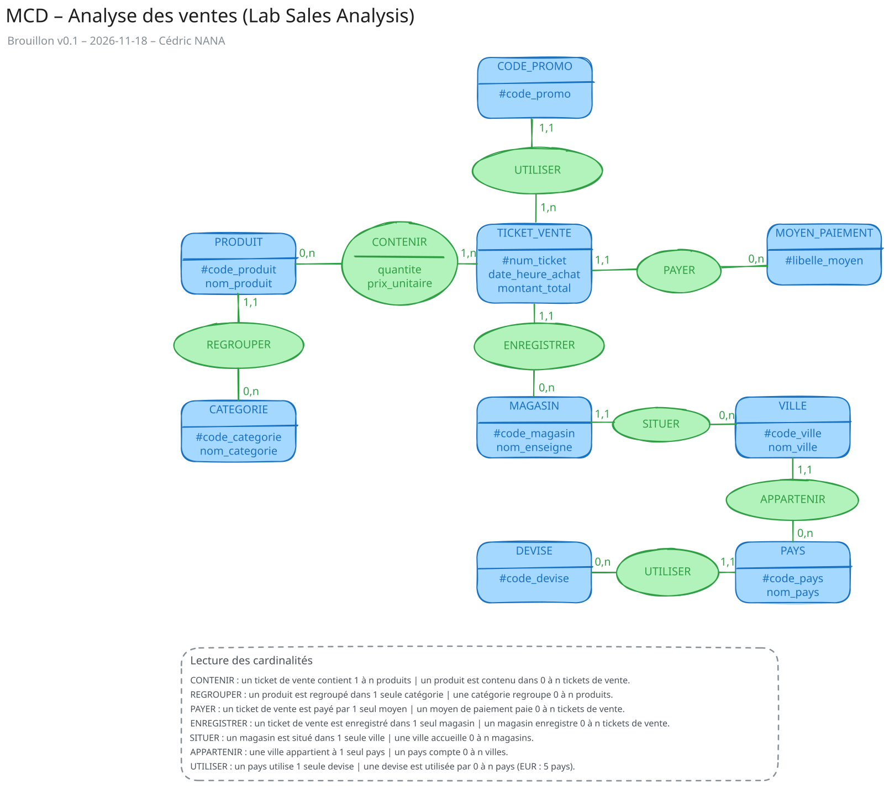
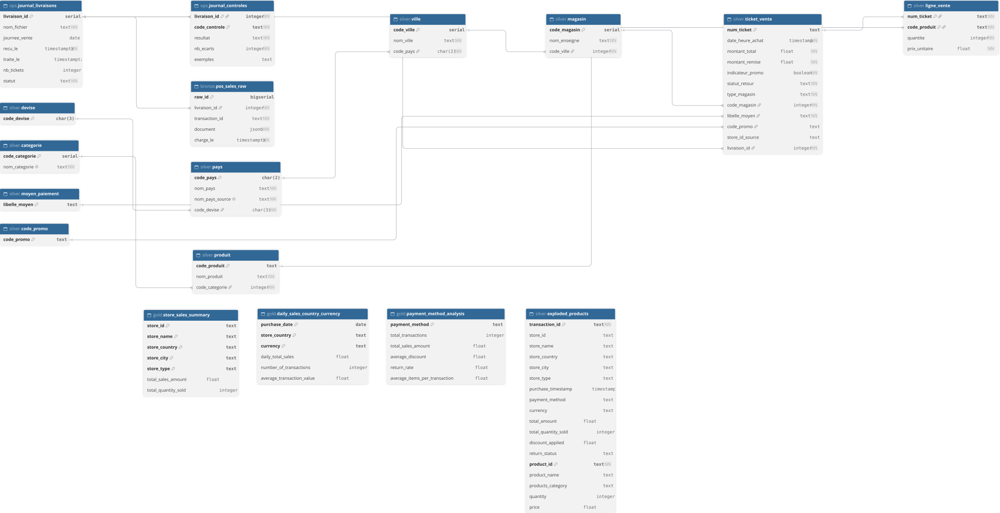

# Lab Sales Analysis


Réalisation d'un pipeline de données qui analyse les ventes d'un réseau international de magasins de sport : il contrôle les livraisons des systèmes de caisse (POS) avant publication puis alimente un rapport Power BI pour suivre l'activité selon les axes d'analyse suivants :

- magasin
- pays
- devise
- moyen de paiement

## Sommaire

1. [Besoin métier](#besoin-métier)
2. [Structure du projet](#structure-du-projet)
3. [Données](#données)
4. [Modèle de données](#modèle-de-données)
5. [Démarrer l'environnement](#démarrer-lenvironnement)
6. [Documentation](#documentation)
7. [État d'avancement](#état-davancement)

## Besoin métier

La direction souhaite obtenir une vue à 360° de son activité commerciale. Le chiffre d'affaires (CA) qu'elle consulte chaque matin peut être faussé par une livraison en retard ou en double, sans que rien ne le signale.

Le projet répond à ces deux problèmes :

- **Analyser l'activité** : trois tables d'analyse qui répondent aux douze questions que se pose le client.
- **Garantir la qualité des données** : aucune donnée incomplète ou en double n'est publiée et le rapport indique jusqu'à quelle date les données sont complètes.

## Structure du projet

```text
Lab_Sales_Analysis/
├── config/             modèles des fichiers de secrets (sans mot de passe)
├── data/
│   └── raw/            fichier source fourni par le client, jamais modifié
├── docs/               documentation du projet
│   └── modeles/        modèles de données (MCD et MPD)
├── scripts/            scripts Python
├── .gitattributes      règles de fins de ligne
├── .gitignore          fichiers exclus du dépôt
├── docker-compose.yml  environnement PostgreSQL et Airflow
└── README.md
```

## Données

Le fichier source `data/raw/pos_sales_data_30k.json` contient 30 000 tickets de caisse enregistrés entre 2023 et 2025 dans 18 pays. Chaque ticket peut contenir plusieurs articles.

## Modèle de données

Le modèle conceptuel de données (MCD, notation Merise) décrit les ventes avec le vocabulaire du métier. Il est construit à partir des constats du [profilage](docs/02_profilage_source.md).



Points clés :

- le **ticket de vente** est au centre : il est payé par un moyen de paiement, enregistré dans un magasin et peut bénéficier d'un code promo ;
- un **magasin** est une enseigne dans une ville (450 magasins), car l'identifiant `store_id` de la source n'est pas fiable ;
- la quantité et le prix appartiennent à la **ligne de vente** (association CONTENIR), car le prix d'un même produit varie d'une vente à l'autre ;
- la **devise** est rattachée au pays : chaque pays utilise une seule devise, et l'euro est partagé par 5 pays.

### Modèle physique

Le modèle physique de données (MPD) traduit le MCD en tables PostgreSQL. Il est écrit en [DBML](docs/modeles/mpd.dbml) et dessiné avec dbdiagram.io. Les tables sont rangées en couches, selon l'architecture médaillon :

| Schéma | Tables | Rôle |
| --- | --- | --- |
| `bronze` | `pos_sales_raw` | Tickets tels que livrés, au format JSON, sans correction |
| `silver` | `exploded_products` et les 10 tables issues du MCD | Données contrôlées : la table intermédiaire demandée par l'énoncé et le modèle métier |
| `gold` | `store_sales_summary`, `daily_sales_country_currency`, `payment_method_analysis` | Tables d'analyse qui répondent aux 12 questions métier |
| `ops` | `journal_livraisons`, `journal_controles` | Suivi de chaque livraison et du résultat des contrôles |



Choix de modélisation :

- les colonnes des tables demandées par l'énoncé sont reprises à l'identique, noms et types compris : les montants sont en `FLOAT`, comme dans l'énoncé ;
- `bronze` conserve le code promo, absent de `exploded_products` ;
- `store_sales_summary` respecte le grain imposé par l'énoncé (`store_id`). Les questions sur les magasins sont aussi calculées sur `silver.magasin`, avec une réserve, car `store_id` n'identifie pas un magasin unique.

## Démarrer l'environnement

L'environnement tourne dans Docker. Le fichier `docker-compose.yml` déclare sept services :

| Service | Rôle | Accès local |
| --- | --- | --- |
| `postgres-ventes` | Base des ventes : schémas bronze, silver, gold et ops | `127.0.0.1:5440` |
| `postgres-airflow` | Base interne d'Airflow (historique des exécutions) | — |
| `airflow-init` | Prépare la base interne d'Airflow, puis s'arrête | — |
| `airflow-apiserver` | Interface web et API d'Airflow | http://127.0.0.1:8090 |
| `airflow-scheduler` | Déclenche les DAG et exécute leurs tâches | — |
| `airflow-dag-processor` | Lit les fichiers du dossier `dags/` | — |
| `airflow-triggerer` | Exécute les tâches différables | — |

Les ports ne sont ouverts que sur la machine locale (`127.0.0.1`).

### 1. Préparer les secrets

Aucun mot de passe n'est stocké dans le dépôt. Les secrets sont lus dans un dossier `data_connection/`:

```text
Bootcamp_Data_Engineer/
├── data_connection/                      hors du dépôt
│   ├── lab_sales_postgres_ventes.env
│   ├── lab_sales_postgres_airflow.env
│   └── lab_sales_airflow.env
└── Lab_Sales_Analysis/                   ce dépôt
```

Copier les trois modèles de `config/` dans ce dossier, sous les noms indiqués en première ligne de chaque modèle puis remplacer chaque `a_remplacer` :

- les mots de passe PostgreSQL : lettres et chiffres uniquement identiques dans les fichiers PostgreSQL et dans `lab_sales_airflow.env` ;
- la clé Fernet qui chiffre les connexions enregistrées dans Airflow :

```powershell
python -c "import base64, os; print(base64.urlsafe_b64encode(os.urandom(32)).decode())"
```

- le secret JWT qui signe les sessions de l'interface (64 caractères) :

```powershell
python -c "import secrets; print(secrets.token_urlsafe(48))"
```

### 2. Lancer les services

```powershell
docker compose up -d
```

```powershell
docker compose ps
```

Au premier lancement `airflow-init` prépare la base d'Airflow : Les autres services passent à l'état `Up`.

### 3. Se connecter

- **Airflow** : http://127.0.0.1:8090.
- **Base des ventes**, depuis pgAdmin ou DBeaver : hôte `127.0.0.1`, port `5440`, base et utilisateur `ventes`, mot de passe de `lab_sales_postgres_ventes.env`.
- **Depuis un DAG** : la connexion Airflow `postgres_ventes` est déclarée dans `lab_sales_airflow.env`.

Utiliser `127.0.0.1` plutôt que `localhost` : sous Windows, `localhost` peut viser une autre adresse et tomber sur un autre serveur.

Si pgAdmin affiche `access violation writing 0x0000000000000000` à la connexion, ajouter dans l'onglet **Parameters** du serveur le paramètre **GSS encmode** (`gssencmode`) à la valeur `disable`.

### 4. Arrêter

```powershell
docker compose down
```

Les données sont conservées dans des volumes Docker. `docker compose down -v` les supprime et repart de zéro.

## Documentation

| Document | Contenu | Version | Mise a jour |
| --- | --- | --- | --- |
| [Note de cadrage métier](docs/01_Besoin_metier.md) | Besoin, utilisateurs, périmètre, indicateurs, règles de gestion et critères de succès | 0.2 | 2026-11-16 |
| [Profilage du fichier source](docs/02_profilage_source.md) | Résultats des contrôles S1 à D6, anomalies, limites et règles proposées pour le contrat de données | 0.2 | 2026-11-19 |
| [Modèle conceptuel de données](docs/modeles/mcd.excalidraw.svg) | Entités, associations et cardinalités du domaine des ventes (Merise) | 0.1 | 2026-11-19 |
| [Contrat de données](docs/03_contrat_donnees.md) | Livraison, schéma source → MCD, valeurs de référence, identification, contrôles de qualité CQ01 à CQ28 et traitement des écarts | 0.1 | 2026-11-19 |
| [Modèle physique de données](docs/modeles/mpd.dbml) | Tables PostgreSQL, clés et relations, rangées en couches bronze, silver, gold et ops | 0.2 | 2026-11-20 |
| [Environnement Docker](docker-compose.yml) | Services PostgreSQL et Airflow, ports, volumes et dépendances de démarrage | 0.1 | 2026-11-19 |

## État d'avancement

Le détail de la réalisation brique par brique est suivi dans le [tableau Kanban du projet](https://github.com/users/cnanaj-wq/projects/1).

- [x] Cadrage métier
- [x] Profilage du fichier source
- [x] Modèle conceptuel de données
- [x] Contrat de données
- [x] Modèle physique de données
- [x] Environnement Docker (PostgreSQL et Airflow)
- [ ] Chargement du fichier JSON
- [ ] DAG Airflow
- [ ] Requêtes des 12 questions métier
- [ ] Extension Snowflake et dbt
- [ ] Rapport Power BI et supervision
