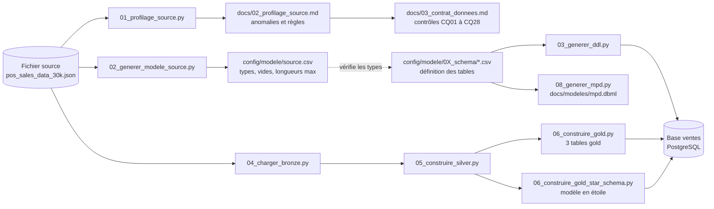

# Scripts Python

Ce dossier contient les scripts du projet. Les deux premiers travaillent sur le fichier source, sans jamais le modifier. Les scripts 04 à 06 forment le pipeline : le DAG Airflow les appelle chaque jour, et ils peuvent aussi être lancés à la main.

| Script | Question à laquelle il répond | Résultat |
| --- | --- | --- |
| [`01_profilage_source.py`](01_profilage_source.py) | Le fichier source est-il fiable, et quelles règles faut-il en tirer ? | Rapport affiché à l'écran, repris dans le [profilage](../docs/02_profilage_source.md) |
| [`02_generer_modele_source.py`](02_generer_modele_source.py) | Quels champs contient le fichier, et avec quel type SQL les stocker ? | Fichier [`config/modele/source.csv`](../config/modele/source.csv) |
| [`03_generer_ddl.py`](03_generer_ddl.py) | Comment créer les tables décrites dans `config/modele/` ? | Fichier `sql/ddl_genere.sql`, exécuté dans la base |
| [`04_charger_bronze.py`](04_charger_bronze.py) | Le fichier livré est-il nouveau et conforme ? | Tickets dans `bronze.pos_sales_raw`, livraison tracée dans `ops.journal_livraisons`, copie dans `data/archive/` |
| [`05_construire_silver.py`](05_construire_silver.py) | Quels tickets de bronze ne sont pas encore dans silver ? | Une ligne par article dans `silver.exploded_products` |
| [`06_construire_gold.py`](06_construire_gold.py) | Que répondent les données aux 12 questions métier ? | Les 3 tables gold, recalculées par les requêtes de `sql/gold/` |
| [`06_construire_gold_star_schema.py`](06_construire_gold_star_schema.py) | Comment servir les données à Power BI ? | Les 4 dimensions et les 2 faits de l'étoile, recalculés par les requêtes de `sql/gold_star_schema/` |
| [`07_creer_role_grafana.py`](07_creer_role_grafana.py) | Comment Grafana lit-il les journaux sans pouvoir rien modifier ? | Rôle `grafana_lecture`, en lecture seule sur le schéma `ops` |
| [`08_generer_mpd.py`](08_generer_mpd.py) | Le schéma du modèle physique correspond-il aux tables créées ? | Fichier [`docs/modeles/mpd.dbml`](../docs/modeles/mpd.dbml), à dessiner dans dbdiagram.io |
| [`09_creer_role_powerbi.py`](09_creer_role_powerbi.py) | Comment Power BI lit-il les données sans pouvoir rien modifier ? | Rôle `powerbi_lecture`, en lecture seule sur les schémas `gold` et `ops` |

Deux modules sont partagés par les scripts :

| Module | Rôle |
| --- | --- |
| [`connexion.py`](connexion.py) | Connexion à la base des ventes : connexion Airflow `postgres_ventes` dans Airflow, fichier de `data_connection/` sur le PC |
| [`messages.py`](messages.py) | Messages horodatés (`log`) et arrêt avec un message clair (`stop`) |

Les scripts 04 à 06 travaillent chacun en une seule transaction : tout est écrit, ou rien ne change.

Lancement depuis la racine du projet, par exemple :

```powershell
python scripts/01_profilage_source.py
```

```powershell
python scripts/08_generer_mpd.py
```

## Place des scripts dans le pipeline



- `01_profilage_source.py` sert à **comprendre** le fichier : ses résultats ont servi à rédiger le document de profilage puis le contrat de données.
- `02_generer_modele_source.py` sert à **construire** : sa fiche des champs sert de référence pour les types des tables décrites dans `config/modele/`.
- `03_generer_ddl.py` et `08_generer_mpd.py` lisent les mêmes fichiers de `config/modele/` : les tables de la base et le MPD restent identiques.
- Dans Airflow, les portes qualité RC01 (après silver) et RC02 (après gold) s'intercalent entre ces scripts : voir le [README du projet](../README.md#pipeline-airflow).

## `01_profilage_source.py` : contrôler le fichier source

Le script lit le fichier une fois, puis réalise sept familles de contrôles, l'une après l'autre. Chaque contrôle porte un code repris dans le document de profilage.


## `02_generer_modele_source.py` : décrire les champs du fichier source

Le script remplit une fiche par champ, en lisant chaque valeur une seule fois, puis écrit une ligne par fiche dans un CSV.


Règles appliquées par `propose_sql_type` :

| Types détectés | Type PostgreSQL proposé |
| --- | --- |
| `texte` | `text` |
| `entier` | `integer` |
| `decimal`, ou `entier` et `decimal` mélangés | `float`, comme dans l'énoncé |
| `horodatage` | `timestamp` |
| `booleen` | `boolean` |
| `liste` ou `objet` | `jsonb` |
| tout autre mélange, ou champ toujours vide | `text`, qui accepte tout |

La longueur max n'est pas utilisée pour fixer la taille des colonnes : les colonnes sont en `text`, comme dans l'énoncé. Elle servira de **contrôle qualité** pour repérer une valeur anormalement longue dans une prochaine livraison.
