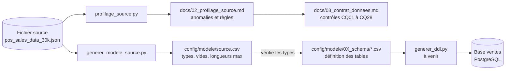
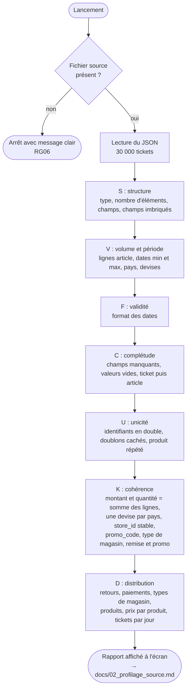
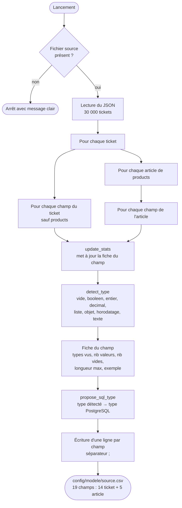

# Scripts Python

Ce dossier contient les scripts du pipeline. Les deux premiers travaillent sur le fichier source, sans jamais le modifier.

| Script | Question à laquelle il répond | Résultat |
| --- | --- | --- |
| [`profilage_source.py`](profilage_source.py) | Le fichier source est-il fiable, et quelles règles faut-il en tirer ? | Rapport affiché à l'écran, repris dans le [profilage](../docs/02_profilage_source.md) |
| [`generer_modele_source.py`](generer_modele_source.py) | Quels champs contient le fichier, et avec quel type SQL les stocker ? | Fichier [`config/modele/source.csv`](../config/modele/source.csv) |

Lancement depuis la racine du projet :

```powershell
python scripts/profilage_source.py
```

```powershell
python scripts/generer_modele_source.py
```

## Place des scripts dans le pipeline



- `profilage_source.py` sert à **comprendre** le fichier : ses résultats ont servi à rédiger le document de profilage puis le contrat de données.
- `generer_modele_source.py` sert à **construire** : sa fiche des champs sert de référence pour les types des tables décrites dans `config/modele/`.

## `profilage_source.py` : contrôler le fichier source

Le script lit le fichier une fois, puis réalise sept familles de contrôles, l'une après l'autre. Chaque contrôle porte un code repris dans le document de profilage.



## `generer_modele_source.py` : décrire les champs du fichier source

Le script remplit une fiche par champ, en lisant chaque valeur une seule fois, puis écrit une ligne par fiche dans un CSV.



Règles appliquées par `propose_sql_type` :

| Types détectés | Type PostgreSQL proposé |
| --- | --- |
| `texte` | `text` |
| `entier` | `integer` |
| `decimal`, ou `entier` et `decimal` mélangés | `numeric(12,2)` |
| `horodatage` | `timestamp` |
| `booleen` | `boolean` |
| `liste` ou `objet` | `jsonb` |
| tout autre mélange, ou champ toujours vide | `text`, qui accepte tout |

La longueur max n'est pas utilisée pour fixer la taille des colonnes : les colonnes sont en `text`, comme dans l'énoncé. Elle servira de **contrôle qualité** pour repérer une valeur anormalement longue dans une prochaine livraison.
